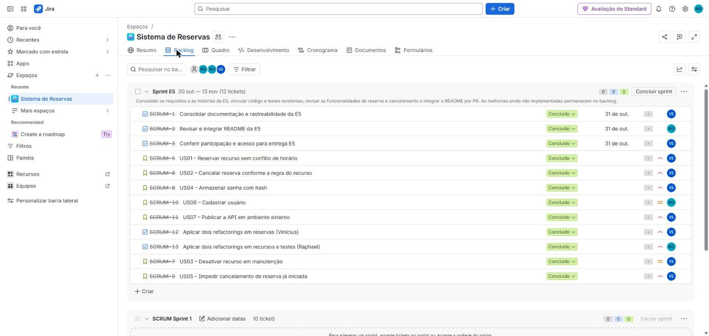

# Sistema de Reservas

API REST para reserva de recursos de uma instituição de ensino: salas de estudo, quadras e equipamentos de laboratório. Usuários (alunos, professores e funcionários) reservam um recurso por um período; o sistema impede conflitos de horário e aplica regras de cancelamento definidas por recurso.

Projeto da disciplina C14 – Engenharia de Software (Inatel, 2026/2). O projeto tem apenas backend.

**Escopo:** o sistema é uma API REST, sem interface gráfica. Ela é usada por chamadas HTTP (curl, Postman ou o navegador, para as consultas), e os endpoints e exemplos estão na seção [Endpoints](#endpoints). Autenticação de usuários (RF15) e edição ou exclusão de registros (RF18) ficaram fora desta entrega.

**API pública:** `https://sistema-reservas-c14.onrender.com`. Por ser apenas uma API, a raiz (`/`) não tem página inicial e responde 404; use os endereços abaixo.
Para conferir no navegador: [saúde da API](https://sistema-reservas-c14.onrender.com/actuator/health), [versão publicada](https://sistema-reservas-c14.onrender.com/actuator/info) e [recursos cadastrados](https://sistema-reservas-c14.onrender.com/recursos).

O Render Free pode hibernar após 15 minutos sem tráfego. A primeira chamada após esse período pode levar cerca de um minuto.

## Tecnologias

- Java 21, Spring Boot 4, Maven (wrapper incluso)
- MySQL 8 no ambiente local, TiDB Cloud Starter no deploy e Flyway (migrations)
- Spring Data JPA, Bean Validation, Lombok, Spring Security Crypto (BCrypt)
- JUnit 5, Mockito, JaCoCo
- Spring Boot Actuator (saúde e commit publicado)
- Jenkins (CI/CD)

### Gerenciamento de dependências e build reproduzível

As dependências são gerenciadas com Maven (`backend/pom.xml`). O build é reproduzível porque:

- o Maven Wrapper (`mvnw` e `mvnw.cmd`) está versionado e fixa o Maven 3.9.16, então todos usam a mesma versão sem instalá-lo;
- o `pom.xml` fixa a versão do Spring Boot (parent 4.0.0), do Java (21) e dos plugins (JaCoCo 0.8.13); as demais dependências usam as versões gerenciadas pelo parent;
- o Jenkins e o Dockerfile chamam sempre o wrapper (`mvnw -B -ntp ...`), sem passos manuais e sem depender de um Maven instalado na máquina.

## Estrutura

```
backend/
  src/main/java/com/reservas/sistemareservas/
    controller/   endpoints REST
    service/      regras de negócio
    repository/   acesso a dados (Spring Data JPA)
    entity/       entidades JPA
    dto/          objetos de entrada e saída da API
    exception/    exceções e tratamento global de erros
  src/main/resources/
    application.properties
    db/migration/ scripts Flyway
  src/test/       testes unitários
Jenkinsfile       pipeline de CI/CD
```

## Como executar

Pré-requisitos: JDK 21 e MySQL rodando em `localhost:3306`. O banco `sistema_reservas` é criado automaticamente, e as tabelas são criadas pelo Flyway na primeira execução.

As credenciais do banco são lidas das variáveis `DB_USERNAME` e `DB_PASSWORD` (padrão: `root`/`root`).

```bash
cd backend
./mvnw spring-boot:run          # Linux/macOS
.\mvnw.cmd spring-boot:run      # Windows
```

A API sobe em `http://localhost:8080`.

Novos cadastros armazenam a senha com BCrypt, com custo 10. A senha deve ter pelo menos 6 caracteres e no máximo 72 bytes em UTF-8; acima desse limite, o cadastro retorna HTTP 422. As respostas de cadastro, consulta e listagem não incluem senha ou hash.

A aplicação não converte registros antigos automaticamente. O único usuário legado do TiDB foi convertido administrativamente em 12/11/2026, com verificação pelo encoder do projeto e preservação de seus vínculos.

## Testes

```bash
cd backend
./mvnw test        # Linux/macOS
.\mvnw.cmd test    # Windows
```

O relatório de cobertura é gerado em `backend/target/site/jacoco/index.html`.

Situação em 14/11/2026 (build #9 do Jenkins na `main`): 57 testes Java (JUnit 5 e Mockito) e 6 testes do script de deploy em PowerShell, todos passando. A cobertura de linhas medida pelo JaCoCo é de 65,9%.

## Endpoints

| Método | Rota | Descrição |
|---|---|---|
| POST | `/usuarios` | Cadastra usuário |
| GET | `/usuarios` | Lista usuários |
| GET | `/usuarios/{id}` | Busca usuário |
| POST | `/recursos/salas` | Cadastra sala de estudo |
| POST | `/recursos/quadras` | Cadastra quadra |
| POST | `/recursos/equipamentos` | Cadastra equipamento de laboratório |
| GET | `/recursos` | Lista recursos |
| GET | `/recursos/{id}` | Busca recurso |
| PATCH | `/recursos/{id}/desativar` | Desativa o recurso (ele deixa de aceitar novas reservas) |
| PATCH | `/recursos/{id}/ativar` | Reativa um recurso desativado (ele volta a aceitar reservas) |
| PUT | `/recursos/{id}/regra-cancelamento` | Define a regra de cancelamento do recurso |
| GET | `/recursos/{id}/regra-cancelamento` | Consulta a regra de cancelamento |
| POST | `/reservas` | Cria reserva |
| GET | `/reservas?usuarioId=&recursoId=` | Lista reservas (filtros opcionais) |
| GET | `/reservas/{id}` | Busca reserva |
| PATCH | `/reservas/{id}/confirmar` | Confirma reserva pendente |
| PATCH | `/reservas/{id}/cancelar` | Cancela reserva ainda não iniciada (422 se já começou; corpo opcional: `{"motivo": "..."}`) |

Exemplo de criação de reserva:

POST /reservas

```json
{
  "usuarioId": 1,
  "recursoId": 2,
  "dataHoraInicio": "2026-12-15T14:00:00",
  "dataHoraFim": "2026-12-15T16:00:00"
}
```

Erros seguem o formato `{"status": 422, "mensagem": "...", "detalhes": []}`.
Use IDs existentes e um período futuro livre ao repetir o exemplo.

Exemplo de uso com `curl`, do cadastro ao cancelamento (a API local sobe em `http://localhost:8080`; troque as datas por um período futuro):

```bash
# 1. cadastrar um usuário (retorna 201)
curl -X POST http://localhost:8080/usuarios -H "Content-Type: application/json" \
  -d '{"nome":"Ana","email":"ana@teste.com","senha":"123456","tipo":"ALUNO"}'

# 2. cadastrar uma quadra (retorna 201)
curl -X POST http://localhost:8080/recursos/quadras -H "Content-Type: application/json" \
  -d '{"nome":"Quadra 1","localizacao":"Bloco A","modalidade":"Futsal","coberta":true}'

# 3. definir a regra de cancelamento do recurso 1
curl -X PUT http://localhost:8080/recursos/1/regra-cancelamento -H "Content-Type: application/json" \
  -d '{"permiteCancelamento":true,"horasMinimasAntecedencia":24,"percentualMulta":30}'

# 4. reservar a quadra (retorna 201; repetir o mesmo horário retorna 409)
curl -X POST http://localhost:8080/reservas -H "Content-Type: application/json" \
  -d '{"usuarioId":1,"recursoId":1,"dataHoraInicio":"2026-12-15T14:00:00","dataHoraFim":"2026-12-15T16:00:00"}'

# 5. cancelar a reserva (retorna a multa aplicada; 422 se a reserva já começou)
curl -X PATCH http://localhost:8080/reservas/1/cancelar

# 6. desativar a quadra; novas reservas passam a retornar 422
curl -X PATCH http://localhost:8080/recursos/1/desativar
```

## Requisitos funcionais

| ID | Requisito | Status |
|---|---|---|
| RF01 | Cadastrar usuário com nome, e-mail, senha (mínimo 6 caracteres e máximo 72 bytes em UTF-8) e tipo (aluno, professor ou funcionário). | Implementado |
| RF02 | Impedir o cadastro de dois usuários com o mesmo e-mail. | Implementado |
| RF03 | Listar usuários e buscar usuário por id, sem expor a senha. | Implementado |
| RF04 | Cadastrar recursos de três tipos: sala de estudo (capacidade, projetor), quadra (modalidade, coberta) e equipamento de laboratório (laboratório, número de patrimônio). | Implementado |
| RF05 | Impedir o cadastro de dois equipamentos com o mesmo número de patrimônio. | Implementado |
| RF06 | Listar recursos e buscar recurso por id. | Implementado |
| RF07 | Definir e consultar a regra de cancelamento de um recurso: antecedência mínima em horas, percentual de multa (0 a 100) e se o cancelamento é permitido. | Implementado |
| RF08 | Criar reserva de um recurso para um usuário, com data e hora de início e fim. | Implementado |
| RF09 | Rejeitar reserva com fim igual ou anterior ao início, ou com início no passado. | Implementado |
| RF10 | Rejeitar reserva que se sobreponha a outra reserva não cancelada do mesmo recurso. Os períodos são tratados como [início, fim), então uma reserva pode começar no horário em que outra termina. | Implementado |
| RF11 | Criar toda reserva com status PENDENTE e permitir a confirmação apenas de reservas pendentes. | Implementado |
| RF12 | Cancelar reserva com motivo opcional, exceto quando ela já estiver cancelada ou quando o recurso não permitir cancelamento. | Implementado |
| RF13 | Aplicar o percentual de multa da regra quando o cancelamento ocorrer com antecedência menor que a mínima. | Implementado |
| RF14 | Listar reservas, com filtro opcional por usuário e/ou recurso, e buscar reserva por id. | Implementado |
| RF15 | Autenticar usuários e permitir que apenas o dono da reserva a cancele. | Não implementado (a API não tem login nem identifica quem cancela) |
| RF16 | Ativar e desativar recursos; recursos inativos não aceitam novas reservas. | Implementado |
| RF17 | Impedir o cancelamento de reservas já iniciadas ou encerradas. | Implementado |
| RF18 | Editar e excluir usuários, recursos e reservas. | Não implementado (não há endpoints de edição nem de exclusão) |

## Requisitos não funcionais

| ID | Requisito | Verificação | Status |
|---|---|---|---|
| RNF01 | Backend em Java 21 com Spring Boot 4, build com Maven via wrapper. | `backend/pom.xml` | Atendido |
| RNF02 | Banco MySQL 8 ou TiDB compatível com MySQL, com esquema versionado por migrations Flyway. | `db/migration/` | Validado com MySQL local e TiDB Cloud via TLS |
| RNF03 | API REST com JSON e códigos HTTP padronizados: 400 (validação), 404 (não encontrado), 409 (conflito), 422 (regra de negócio). | `GlobalExceptionHandler` | Atendido |
| RNF04 | Erros tratados pelo `GlobalExceptionHandler` no formato `{status, mensagem, detalhes}`. | `ErroResponse` | Atendido |
| RNF05 | Sinalizar o build como instável quando a cobertura de linhas ficar abaixo de 40%. | Quality gate no Jenkins | Configurado; cobertura de linhas de 65,9% no build #9 (14/11/2026) |
| RNF06 | Automatizar build, testes, publicação de cobertura e deploy pelo Jenkins. | `Jenkinsfile` e `scripts/deploy-render.ps1` | Implementado; build #9 do Jenkins na `main` verde, com deploy no Render |
| RNF07 | Credenciais do banco configuráveis por variáveis de ambiente (`DB_USERNAME`, `DB_PASSWORD`). | `application.properties` | Atendido |
| RNF08 | Senhas armazenadas com hash (BCrypt), nunca em texto puro. | `SenhaConfig`, `UsuarioService` e testes de usuário | Integrado pelo PR #11. Usuário legado do TiDB convertido em 12/11/2026. |
| RNF09 | Disponibilizar a API por HTTPS fora da máquina do Jenkins, com banco persistente compatível com MySQL. | Docker, Render, TiDB e health check | API pública e persistência após novo deploy verificadas em 13/11/2026 |

## CI/CD

A pipeline está no `Jenkinsfile` e roda em um agente Windows. A etapa Quality Gate foi separada da publicação da cobertura no [PR #16](https://github.com/C14-Inatel-2026-2/sistema-reservas-projeto-c14/pull/16), de Vinícius:

1. **Build:** compila e gera o `.jar`.
2. **Testes:** executa os testes Java e seis testes do script de deploy; publica ambos no JUnit.
3. **Quality Gate:** lê o relatório do JaCoCo e marca o build como instável se a cobertura de linhas ficar abaixo de 40%.
4. **Cobertura:** publica o relatório HTML do JaCoCo.
5. **Deploy:** na `main`, com build bem-sucedido e cobertura aprovada, aciona o Render para o SHA testado. Aguarda `/actuator/health` com status `UP` e `/actuator/info` com o mesmo commit. PRs e branches de desenvolvimento não publicam a aplicação.

O Jenkins usa um agente Windows com JDK 21 e as credenciais `render-deploy-hook` e `render-service-url`, já cadastradas. O build #9 na `main` executou as cinco etapas com sucesso (detalhes em [Validação do deploy](#validação-do-deploy)).

## Deploy externo

A API está publicada no **Render Free**, com banco **TiDB Cloud Starter, MySQL Compatible**, ambos em Virginia (`us-east-1` no TiDB). O BCrypt está integrado pelo PR #11. O deploy pelo Jenkins foi validado no build #9, descrito em [Validação do deploy](#validação-do-deploy).

### Testar com Docker localmente

Copie `.env.example` para `.env` e preencha `DB_PASSWORD` e `MYSQL_ROOT_PASSWORD` com senhas de teste. Depois, na raiz do repositório:

```powershell
docker compose -p c14-reservas up -d --build
.\scripts\Test-LocalDeploy.ps1
docker compose -p c14-reservas down
```

A API fica em `http://127.0.0.1:8081`. O teste cria registros fictícios, reinicia a aplicação, verifica a persistência e interrompe e religa o banco para validar o health check. O volume do MySQL é preservado pelo comando `down`. A aplicação usa Java 21 e roda com usuário sem privilégios, limitada a 512 MB no Compose.

### Banco no TiDB Cloud

Crie uma instância **Starter**, modo **MySQL Compatible**, AWS **N. Virginia (`us-east-1`)**, com **Monthly Spending Limit = US$ 0**. A franquia inclui 5 GiB de armazenamento de linhas e 50 milhões de Request Units por mês; ao esgotar a franquia, o acesso é limitado. Não habilite planos pagos. [Planos e limites](https://docs.pingcap.com/tidbcloud/select-cluster-tier/).

No SQL Editor da instância, execute [scripts/preparar-tidb.sql](scripts/preparar-tidb.sql) **antes da primeira inicialização da API**. Ele habilita `tidb_enable_check_constraint`, cria `sistema_reservas` com `utf8mb4_0900_ai_ci` e exibe os valores para conferência. O primeiro resultado deve ser `1`, e a collation deve ser `utf8mb4_0900_ai_ci`. As tabelas continuam sendo criadas pela migration V1 original do Flyway.

Em **Connect**, obtenha host, porta, usuário completo (incluindo o prefixo da instância) e senha. Restrinja o firewall aos endereços de saída do serviço no Render; permita o IP local apenas durante a validação. As credenciais ficam nas variáveis de ambiente do serviço.

No ambiente publicado, a lista de acesso do TiDB contém apenas os intervalos `74.220.49.0/24` e `74.220.57.0/24`, informados pelo Render para o serviço em Virginia em 13/11/2026. A regra de acesso de qualquer IP foi removida. Consulte **Connect > Outbound IP Addresses** do serviço ao revisar essa configuração.

### API no Render

Após integrar os PRs, crie um **Web Service** na região **Virginia**, com o repositório público do grupo, branch `main`, linguagem **Docker**, Dockerfile `./Dockerfile`, contexto `.` e plano **Free**. Defina o health check como `/actuator/health` e desative o deploy automático; o Jenkins aciona a publicação pelo hook. O arquivo `render.yaml` registra essa configuração. [Docker no Render](https://render.com/docs/docker).

Configure estas variáveis no Render:

| Variável | Valor |
|---|---|
| `SPRING_PROFILES_ACTIVE` | `prod` |
| `DB_URL` | JDBC URL abaixo, substituindo `HOST` e `PORTA` pelos valores do TiDB |
| `DB_USERNAME` | Usuário completo informado pelo TiDB |
| `DB_PASSWORD` | Senha do banco |

```text
jdbc:mysql://HOST:PORTA/sistema_reservas?sslMode=VERIFY_IDENTITY&enabledTLSProtocols=TLSv1.2,TLSv1.3&serverTimezone=UTC
```

A conexão verifica o certificado e o hostname usando as autoridades certificadoras do Java 21; não é necessário criar um truststore próprio. A senha fica separada em `DB_PASSWORD`. As credenciais não devem entrar no Git. A porta é lida de `PORT`, fornecida pelo Render. O pool usa até três conexões, com renovação em cinco minutos e keepalive de dois minutos.

O Render Free suspende serviços após 15 minutos sem tráfego, e a retomada pode levar cerca de um minuto. Abra a aplicação antes da demonstração. [Limites do plano Free](https://render.com/docs/free).

### Acionar pelo Jenkins

Cadastre duas credenciais do tipo **Secret text**, com estes IDs:

| ID | Conteúdo |
|---|---|
| `render-deploy-hook` | Deploy Hook obtido nas configurações do serviço no Render |
| `render-service-url` | `https://sistema-reservas-c14.onrender.com` |

O script envia o SHA da pipeline no parâmetro `ref` do hook e espera por até 15 minutos pela aplicação saudável nessa versão. O hook não é escrito nos logs. Um build instável por cobertura abaixo de 40% não executa o deploy. [Deploy hooks do Render](https://render.com/docs/deploy-hooks).

Os seis testes desse script podem ser executados sem Jenkins nem acesso ao Render:

```powershell
.\scripts\Test-DeployRender.ps1 -ReportPath backend/target/surefire-reports/TEST-DeployRender.xml
```

### Validação do deploy

Em 05/11/2026: imagem Docker gerada; 36 testes Java e seis testes do script passaram. Com MySQL 8.4 real e perfil `prod`, o teste local confirmou cadastro de usuário/recurso/reserva, persistência após reiniciar, HTTP 503 sem banco e recuperação após religá-lo.

Em 12/11/2026: a aplicação executou com TiDB 8.5.2 local e limite de 512 MB. A migration original passou; foram verificados cadastro, reserva, conflito de horário (HTTP 409), consulta com filtros, confirmação e cancelamento. Os três `CHECK` e as chaves estrangeiras rejeitaram dados inválidos. Os registros persistiram após reiniciar a API e o banco, e o health check retornou HTTP 503 com o banco interrompido. O consumo observado da API foi de aproximadamente 352 MB.

Na mesma data, a imagem Docker foi conectada ao TiDB Cloud Starter 8.5.3 em Virginia, com `sslMode=VERIFY_IDENTITY` e as autoridades certificadoras padrão do Java 21. A migration V1 original criou as tabelas; os três `CHECK` e as chaves estrangeiras rejeitaram inserções inválidas. Cadastro, e-mail único, reserva, conflito de horário e confirmação passaram. Após substituir o contêiner da API, o usuário e a reserva confirmada continuaram salvos no banco. Também passaram os 36 testes Java e os seis testes do script de deploy, estes no PowerShell 5.1 e 7. A URL pública no Render e a execução da pipeline no Jenkins foram validadas depois, como descrito abaixo.

Em 13/11/2026, o Render publicou a `main` no commit `1dbd0f707ee3c3112d2a43f5bb04d3474732f5df`. A URL HTTPS respondeu com saúde `UP` e o SHA esperado. Passaram 12 grupos de verificações pela API, incluindo os três tipos de recurso, validações de cadastro, unicidade, conflito de horário, períodos adjacentes, confirmação e regras de cancelamento. Após um novo deploy pelo hook, o usuário e a reserva confirmada permaneceram salvos. Essa execução partiu da máquina local; a execução pelo Jenkins está descrita no parágrafo seguinte. [Evidência da publicação](docs/evidencias/deploy-publico.json).

Em 14/11/2026, o build #9 do Jenkins na `main` (commit `6efcef9`, merge do PR #17) passou por Build, Testes, Quality Gate, Cobertura e Deploy, usando as credenciais `render-deploy-hook` e `render-service-url`. Os 57 testes Java passaram sem falhas e a cobertura de linhas ficou em 65,9%, acima do mínimo de 40%. O Deploy confirmou o commit `6efcef9` no Render, e `/actuator/info` e `/actuator/health` responderam com esse commit e status `UP`. O aviso "Source file ... not found" do plugin de cobertura é inofensivo e não afeta o resultado. [Print do build #9](docs/evidencias/jenkins-build-9-main.jpg).

Na revisão dos critérios do Jira, passaram também os 12 critérios das histórias US01, US02 e US06 na mesma versão pública: sobreposição parcial das 14h–16h com 15h–17h recusada, período adjacente aceito, períodos inválidos rejeitados, multa configurável de 20% aplicada conforme a antecedência, cancelamento bloqueado sem alterar o status e cadastro dos três tipos de usuário sem senha/hash nas respostas. [Resultados por critério](docs/evidencias/criterios-publicos.json).

Para repetir a verificação e guardar os IDs de registros fictícios:

```powershell
.\scripts\Test-CriteriosApi.ps1 -BaseUrl https://sistema-reservas-c14.onrender.com -Commit SHA_COMPLETO -StatePath backend/target/aceite-api.json
# Depois de um novo deploy, confira os mesmos registros:
.\scripts\Test-DeployExterno.ps1 -BaseUrl https://sistema-reservas-c14.onrender.com -Commit SHA_PUBLICADO -Fase Conferir -StatePath backend/target/aceite-api.json
```

O estado do teste e o resumo `aceite-api.resultado.json` ficam em `backend/target`, fora do Git. O script usa outras reservas para cancelamento, preservando a reserva confirmada para a prova de persistência.

## Refactorings

Tarefas: [reservas / SCRUM-12](https://reservas-c14.atlassian.net/browse/SCRUM-12) e [recursos e testes / SCRUM-13](https://reservas-c14.atlassian.net/browse/SCRUM-13).

| Autor | Smell | Refactoring e motivo | Evidência | Situação |
|---|---|---|---|---|
| Vinícius | `criar` mistura validação, montagem e persistência. | Extrair `montarReserva`, separando a construção da entidade das verificações. | [PR #8](https://github.com/C14-Inatel-2026-2/sistema-reservas-projeto-c14/pull/8), commit `476febb` | Integrado pelo PR #8; Jenkins verde antes e depois |
| Vinícius | `cancelar` concentra regra, cálculo de multa e mudança de estado. | Extrair `calcularPercentualMulta`, preservando o mesmo instante e a comparação de antecedência. | [PR #8](https://github.com/C14-Inatel-2026-2/sistema-reservas-projeto-c14/pull/8), commit `1b6f428` | Integrado pelo PR #8; Jenkins verde antes e depois |
| Raphael | Mapeamento extenso dos tipos de recurso: `RecursoResponse.de` concentra o mapeamento de todos os tipos em um só método (método longo). | Extrair `deSala`, `deQuadra`, `deEquipamento` e `deRecursoBase`. O motivo é deixar `de` apenas escolhendo o tipo e isolar cada mapeamento, o que facilita ler e alterar um tipo sem mexer nos outros; campos e proxies foram preservados. | [PR #13](https://github.com/C14-Inatel-2026-2/sistema-reservas-projeto-c14/pull/13), commit `3828d14` | Aplicado; Jenkins verde antes e depois; revisado e mesclado |
| Raphael | Preparação repetida nos testes de cancelamento: os mesmos mocks de reserva e de regra são configurados em cada teste (código duplicado). | Extrair os helpers `dadoReservaExistente` e `dadoRegraDoRecurso` em `ReservaServiceTest`. O motivo é reduzir a duplicação e deixar cada teste mostrando só o que o diferencia; as verificações não mudaram, e foram dois helpers porque um teste não pode configurar o repositório de regras. | [PR #13](https://github.com/C14-Inatel-2026-2/sistema-reservas-projeto-c14/pull/13), commit `b4beaac` | Aplicado; Jenkins verde antes e depois; revisado e mesclado |

Em 12/11/2026, `mvnw.cmd -B -ntp clean verify` com JDK 21 passou antes e depois dos dois refactorings de Vinícius: 40 testes, sem falhas. A cobertura de linhas foi de 61,93% para 62,50%. Os quatro testes novos e as verificações adicionais foram registrados antes das extrações, no commit `4ec64e1`; não contam como refactorings.

Resumos da validação local: [antes](docs/evidencias/refactor-reservas-antes.json) e [depois](docs/evidencias/refactor-reservas-depois.json). Os relatórios completos JUnit e JaCoCo foram preservados localmente. Os builds do Jenkins antes e depois foram executados em 13/11/2026 e estão resumidos mais abaixo.

O PR #8 combinou o deploy do PR #7 e a restauração do BCrypt do PR #11, que foi integrado antes dele. Os builds do Jenkins antes e depois estão registrados mais abaixo.

Na base integrada, as duas referências passaram em 48 testes Java e seis testes PowerShell. A cobertura de linhas foi de 64,18% antes para 64,71% depois. Os testes e a infraestrutura são iguais nas duas referências; no código de produção mudam apenas as duas extrações em `ReservaService`.

Referências para o Jenkins: `ci/reservas-antes` e `refactor/reservas`, no fork do Vinícius. [Configuração dos builds](docs/evidencias/jenkins-refactorings.md) · [resultado local antes](docs/evidencias/refactor-integrado-antes.json) · [resultado local depois](docs/evidencias/refactor-integrado-depois.json).

Em 13/11/2026, o Jenkins executou a pipeline sobre os refactorings de Raphael: `4a2f333` (antes, a `main`) e `9efac7e` (depois, branch `refactor/recursos-e-testes`). Os dois builds terminaram com sucesso, com 54 testes (48 Java e seis do script de deploy), sem falhas, e o stage Deploy pulado por não ser a `main`. A cobertura de linhas foi de 64,71% para 65,22%; o aumento vem dos métodos extraídos, executados pelos mesmos testes. Resumos: [antes](docs/evidencias/refactor-recursos-antes.json) e [depois](docs/evidencias/refactor-recursos-depois.json).

Na mesma data, o Jenkins executou a pipeline sobre as referências dos refactorings de Vinícius, no fork dele: `0466e2c` (antes, `ci/reservas-antes`) e `29ee4af` (depois, `refactor/reservas`, integrado pelo PR #8). Os dois builds terminaram com sucesso, com 54 testes (48 Java e seis do script de deploy), sem falhas, e o stage Deploy pulado. A cobertura de linhas foi de 64,18% para 64,71%, igual à validação local registrada acima.

## Gestão do projeto

[Quadro no Jira](https://reservas-c14.atlassian.net/jira/software/projects/SCRUM/boards/1) · [Backlog](https://reservas-c14.atlassian.net/jira/software/projects/SCRUM/boards/1/backlog)

O quadro foi organizado em 30/10/2026 com Scrum adaptado à equipe de dois integrantes. A **Sprint E5** foi de 30/10 a 13/11/2026 e teve como objetivo consolidar a documentação da E5, vincular código e testes e revisar os critérios de aceite das funcionalidades existentes.

Escolhemos Scrum adaptado porque o projeto é entregue em etapas curtas com data fixa (a Sprint E5 coincide com a entrega E5), o trabalho já se organizava em histórias de usuário com critérios de aceite, e o Jira oferece quadro, backlog e histórico sem custo. Com dois integrantes, adaptamos o Scrum: o planejamento e o acompanhamento acontecem pelo quadro e pelo chat do grupo.

Vinícius organiza o Jira, os requisitos e a documentação; Raphael mantém a pipeline e participa da revisão. Ambos desenvolvem e revisam as alterações do outro. Nos papéis do Scrum, Vinícius atua como Scrum Master e Raphael como Product Owner, responsável por priorizar o backlog, e ambos acumulam o papel de desenvolvedores.

O planejamento seleciona os itens no início da sprint. O acompanhamento ocorre pelo quadro e pelo chat do grupo, com atualização a cada mudança de status e registro dos impedimentos. A retrospectiva da sprint está registrada em [Lições aprendidas](#lições-aprendidas). O histórico dessas práticas começa com a adoção do Jira; as funcionalidades anteriores foram relacionadas ao código retrospectivamente.

Fluxo de trabalho:

- **To Do:** item planejado, aguardando execução.
- **In Progress:** implementação, documentação ou validação em andamento.
- **In Review:** aguardando revisão de PR ou validação dos critérios de aceite.
- **Done:** critérios verificados e alteração integrada.

Para iniciar um item (DoR), a história deve ter objetivo, critérios de aceite, prioridade, requisito relacionado e responsável, com dependências identificadas. Para concluir (DoD), os critérios devem ser atendidos, os testes relevantes devem passar, a documentação deve estar atualizada e o PR deve ser aprovado por outro integrante e integrado. Alterações de código também precisam passar pela pipeline.

Cada mudança usa uma branch e um PR; o outro integrante revisa, aprova e faz o merge. O PR deve citar a chave do Jira, por exemplo `SCRUM-8`. O cartão recebe o link do PR e dos testes correspondentes.

A revisão formal por PR, com aprovação do outro integrante, passou a ser aplicada a partir dos PRs #13, #14, #16 e #17. Os PRs anteriores não tiveram essa revisão no momento do merge; cinco deles (#3, #6, #7, #8 e #11) receberam revisão retroativa em 13/11/2026, registrada como comentário.

O acompanhamento considera a quantidade de itens por status e os itens concluídos por sprint, a partir do quadro do Jira.

Métrica da Sprint E5 (30/10 a 13/11/2026): **12/12 itens concluídos** (7 histórias de usuário, 3 tarefas de documentação e processo e 2 tarefas de refactoring).



### Histórias de usuário

Os critérios foram verificados nos testes automatizados e chamando a API em execução.

| História | Jira | Prioridade | Status final | Implementação | Testes |
|---|---|---|---|---|---|
| US01 Reservar recurso | SCRUM-5 | Alta | Entregue | commit `b760cab` (primeira entrega, sem PR) e [PR #1](https://github.com/C14-Inatel-2026-2/sistema-reservas-projeto-c14/pull/1) (validação de horários) | `ReservaServiceTest` (criar_*), `ValidadorHorarioReserva*Test` ([#1](https://github.com/C14-Inatel-2026-2/sistema-reservas-projeto-c14/pull/1), [#2](https://github.com/C14-Inatel-2026-2/sistema-reservas-projeto-c14/pull/2)) |
| US02 Cancelar reserva | SCRUM-6 | Alta | Entregue | commit `b760cab` (sem PR) e [PR #8](https://github.com/C14-Inatel-2026-2/sistema-reservas-projeto-c14/pull/8) (refactor do cálculo de multa) | `ReservaServiceTest` (cancelar_*), commit `102fc18` e [PR #2](https://github.com/C14-Inatel-2026-2/sistema-reservas-projeto-c14/pull/2) |
| US03 Desativar recurso | SCRUM-7 | Média | Entregue | [PR #14](https://github.com/C14-Inatel-2026-2/sistema-reservas-projeto-c14/pull/14) | `RecursoServiceTest` |
| US04 Senha com hash | SCRUM-8 | Média | Entregue | [PR #6](https://github.com/C14-Inatel-2026-2/sistema-reservas-projeto-c14/pull/6), revertido no [PR #10](https://github.com/C14-Inatel-2026-2/sistema-reservas-projeto-c14/pull/10) e restaurado no [PR #11](https://github.com/C14-Inatel-2026-2/sistema-reservas-projeto-c14/pull/11) | `UsuarioServiceTest`, `UsuarioControllerTest` |
| US05 Bloquear cancelamento após o início | SCRUM-9 | Média | Entregue | [PR #14](https://github.com/C14-Inatel-2026-2/sistema-reservas-projeto-c14/pull/14) e [PR #17](https://github.com/C14-Inatel-2026-2/sistema-reservas-projeto-c14/pull/17) (testes de limite) | `ReservaServiceCancelamentoIniciadaTest` |
| US06 Cadastrar usuário | SCRUM-10 | Alta | Entregue | commit `b760cab` (sem PR); registro da história no [PR #5](https://github.com/C14-Inatel-2026-2/sistema-reservas-projeto-c14/pull/5) | `UsuarioServiceTest`, `UsuarioControllerTest` (commit `102fc18`) |
| US07 Deploy externo | SCRUM-11 | Média | Entregue | commit `9b05d2b` (Jenkinsfile), [PR #7](https://github.com/C14-Inatel-2026-2/sistema-reservas-projeto-c14/pull/7) e [PR #12](https://github.com/C14-Inatel-2026-2/sistema-reservas-projeto-c14/pull/12) | testes do script de deploy (PowerShell) |

#### US01 — Reservar recurso
Como usuário (aluno, professor ou funcionário), quero reservar um recurso em um período para garantir seu uso sem conflito com outras reservas.
- **Dado** um recurso ativo e livre, **quando** reservo um período futuro, **então** a reserva é criada com status PENDENTE (201).
- **Dado** uma reserva das 10h às 11h, **quando** alguém reserva das 10h30 às 11h30, **então** o sistema recusa (409).
- **Dado** uma reserva das 10h às 11h, **quando** alguém reserva das 11h às 12h, **então** a reserva é aceita (201).
- **Dado** início no passado, fim igual ou anterior ao início, ou recurso inativo, **quando** tento reservar, **então** o sistema recusa (422).

#### US02 — Cancelar reserva
Como usuário, quero cancelar uma reserva para liberar o recurso, sabendo a multa prevista na regra daquele recurso.
- **Dado** regra de 24h de antecedência e 30% de multa, **quando** cancelo com 3 dias de antecedência, **então** não há multa.
- **Dado** a mesma regra, **quando** cancelo com cerca de 2h de antecedência, **então** a multa é de 30%.
- **Dado** um recurso que não permite cancelamento, **quando** cancelo, **então** o sistema recusa (422).
- **Dado** uma reserva já cancelada, **quando** cancelo de novo, **então** o sistema recusa (422) e preserva os dados.

#### US03 — Desativar recurso
Como gestor de recursos, quero desativar um recurso para que ele deixe de aceitar novas reservas.
- **Dado** um recurso ativo, **quando** chamo `PATCH /recursos/{id}/desativar`, **então** o recurso continua cadastrado com `ativo=false`.
- **Dado** um recurso desativado, **quando** alguém tenta reservá-lo, **então** o sistema recusa (422).
- **Dado** um recurso desativado, **quando** chamo `PATCH /recursos/{id}/ativar`, **então** ele volta a aceitar reservas (201 ao reservar um período livre).
- **Dado** um id inexistente, **quando** tento desativar ou reativar, **então** o sistema responde 404.

#### US04 — Senha com hash
Como usuário, quero que minha senha seja guardada com hash para que ela não seja exposta em caso de vazamento.
- **Dado** um cadastro válido, **quando** o usuário é salvo, **então** a senha fica armazenada com BCrypt (custo 10).
- **Dado** qualquer consulta de usuário, **quando** a API responde, **então** a resposta não traz senha nem hash.
- **Dado** uma senha com mais de 72 bytes, **quando** me cadastro, **então** o sistema recusa (422).

#### US05 — Bloquear cancelamento após o início
Como usuário, quero que reservas já iniciadas não possam ser canceladas para manter o histórico de uso consistente.
- **Dado** uma reserva cujo horário de início já passou, **quando** alguém tenta cancelá-la, **então** o sistema recusa (422) e mantém status e dados.
- **Dado** uma reserva que ainda não começou, **quando** alguém a cancela, **então** o cancelamento continua permitido.

#### US06 — Cadastrar usuário
Como pessoa da instituição, quero me cadastrar como aluno, professor ou funcionário para poder fazer reservas.
- **Dado** dados válidos, **quando** me cadastro, **então** o usuário é criado (201).
- **Dado** um e-mail já cadastrado, **quando** outro cadastro o usa, **então** o sistema recusa (409).
- **Dado** um e-mail inválido, **quando** me cadastro, **então** o sistema recusa (400).

#### US07 — Deploy externo
Como equipe, quero a API publicada em uma URL pública para que possa ser usada e avaliada sem rodar localmente.
- **Dado** um commit na `main` com testes e cobertura aprovados, **quando** a pipeline termina, **então** o stage Deploy aciona o Render, que publica esse commit.
- **Dado** a aplicação publicada, **quando** consulto `/actuator/health` e `/actuator/info`, **então** vejo `UP` e o commit publicado.

As tarefas de acompanhamento são [documentação / SCRUM-1](https://reservas-c14.atlassian.net/browse/SCRUM-1), [revisão do README / SCRUM-2](https://reservas-c14.atlassian.net/browse/SCRUM-2) e [participação, acesso e envio / SCRUM-3](https://reservas-c14.atlassian.net/browse/SCRUM-3). Elas substituíram os cartões de exemplo criados no cadastro inicial.

## Dinâmica de desenvolvimento

### Divisão de tarefas e decisões

| Área | Quem |
|---|---|
| Base do backend: entidades, migration, API, testes unitários, pipeline inicial no Jenkins | Raphael |
| Validação de horários e testes de cancelamento, quality gate de cobertura, BCrypt, deploy no Render com TiDB, refactorings de reservas | Vinícius |
| Jira, requisitos e documentação | Vinícius |
| Manutenção do pipeline, merge dos PRs e refactorings de recursos e testes | Raphael |

As decisões foram tomadas em conversa no chat do grupo. As principais: Spring Boot, Maven, MySQL e Flyway; herança entre os tipos de recurso; uma regra de cancelamento por recurso; validação de horário isolada em uma classe sem banco, para ser testável; Jenkins; e deploy externo no Render para ter a API publicada. O escopo é só o backend (API REST), sem interface gráfica.

### Branches, commits e revisão

- **Commits:** padrão Conventional Commits em português (`feat`, `fix`, `test`, `docs`, `chore`, `ci`, `refactor`).
- **Branches:** no início, parte do código foi enviada direto para a `main`. Depois, o Vinícius passou a abrir PRs a partir de branches do fork dele. Há várias PRs, e a `main` foi atualizada por merge.
- **Revisão:** Os PRs foram mesclados sem revisões nem comentários registrados no GitHub; as revisões dos PRs anteriores foram feitas depois e as dos novos passaram a ser registradas no GitHub antes do merge.

### Conflitos e bloqueios

- **Repositório no lugar errado:** foi criado na conta pessoal em vez da organização e precisou ser transferido, com permissões de admin.
- **Ambiente local:** a porta 8080 estava ocupada (a API passou a rodar na 8081) e o MariaDB local desligava sozinho, derrubando o deploy local.
- **Jenkins:** o primeiro build falhou por causa do `mvnw.cmd` no Windows; foram necessárias cinco correções (`fix(ci)`) até o deploy local funcionar. Esse deploy foi depois substituído pelo deploy no Render.
- **Testes dependentes de banco:** o teste de contexto do Spring exigia MySQL e quebraria na CI; foi trocado por um teste de controller sem banco.
- **BCrypt:** a hash de senha entrou (PR #6), foi revertida (PR #10) e restaurada sobre a base com deploy externo (PR #11).
- **Histórico:** a `main` foi reescrita uma vez, em 17/10/2026, para remover uma linha de coautoria de IA de uma mensagem de commit.

### Lições aprendidas

1. Adotar PRs com revisão registrada desde o primeiro commit, e não só mais tarde.
2. Montar a pipeline e o ambiente de deploy cedo, antes de acumular código.
3. Não depender de banco local nos testes unitários.
4. Combinar cedo credenciais, ambientes e portas.

## Uso de IA

O grupo usou IA de forma ampla e declara isso aqui. Cada integrante registra o próprio uso.

### Modelos utilizados

| Integrante | Ferramenta e modelos |
|---|---|
| Raphael | Claude Code (Claude Sonnet 5 e Sonnet 5.5), em sessões de conversa no desktop |
| Vinícius | Claude Code (Claude Opus 5.5) e Codex, em sessões de conversa no desktop |

### Para que foi usada

- **Raphael:** estrutura inicial do projeto Spring Boot, entidades JPA, migration Flyway, repositories, services, controllers e DTOs; instalação e configuração do Jenkins; análise dos refactorings de recursos e testes e execução dos builds de validação.
- **Vinícius:** leitura do repositório, rascunho de requisitos e documentação, apoio ao Jenkinsfile e cadastro das histórias no Jira. No deploy externo, Codex apoiou Dockerfile, configuração por variáveis, script do Jenkins, testes e documentação.

### Exemplos reais de prompts

| # | Prompt (trecho, data) | O que a IA entregou | Aceito, ajustado ou descartado |
|---|---|---|---|
| 1 | "Inicie um projeto spring boot utilizando mysql, Lombok, DevTools e Spring web. Maven… JUnit 5 + Mockito… Flyway… e já crie somente as entidades e a estrutura de pastas do sistema" | Projeto Spring Boot 4.0.0, pacotes por camada e sete entidades (Usuário, Recurso com herança para sala, quadra e equipamento, regra de cancelamento, reserva) | Aceito, com ajuste: a IA removeu um enum que ficou sem uso e deixou `ddl-auto=none` até existir migration. |
| 2 | "Vamos definir e levantar os requisitos para os Repositories e controllers da aplicação" | Requisitos para a criação dos Repositories e controllers, e também DTOs, services, exceções e tratador global de erros, porque os controllers dependem deles | Aceito. A IA apontou que a senha estava em texto puro; isso foi corrigido depois por Vinícius com BCrypt (PRs #6 e #11). |
| 3 | "Preparar a API Java 21 para deploy no Render com Docker e TiDB, utilizando variáveis de ambiente, TLS e health check. Integrar ao Jenkins e verificar se o SHA publicado corresponde ao commit testado." | Configuração de deploy com Docker, integração com TiDB, variáveis de ambiente, TLS e health check. Integração com Jenkins e validação do SHA do commit publicado. | Aceito. Configuração aplicada no PR #7 e deploy externo validado, confirmando a correspondência entre o código testado e o publicado. |
| 4 | "Refatorar o ReservaService, separando a montagem da reserva e o cálculo da multa em métodos próprios, preservando as regras existentes e validando o comportamento com testes antes e depois." | Refatoração do ReservaService, extraindo métodos específicos para montagem da reserva e cálculo da multa. Execução de testes antes e depois das alterações para verificar a preservação das regras de negócio. | Aceito. Extrações aplicadas no PR #8, com testes antes e depois para validar que o comportamento original foi preservado. |

Sugestão descartada: a IA propôs simplificar os DTOs (records para classes) e encurtar os nomes dos testes; o grupo manteve o código como estava.

### Dinâmica de uso

O uso foi individual. A IA gerou alguns códigos, executou comandos e ajudou com a documentação. Não houve revisão de PR feita por IA no GitHub; a revisão dos PRs é entre os integrantes.

### O que não foi feito por IA

- **Definição do projeto:** o tema (reserva de salas, quadras e equipamentos), as regras de negócio (uma regra de cancelamento por recurso, com antecedência mínima e multa) e a decisão de entregar só o backend foram definidos pelos integrantes. *(Raphael)*
- **Teste do `UsuarioController`:** teste do `UsuarioController` sem banco de dados, no lugar do teste de contexto *(Raphael)*
- **Decisões de ferramenta:** usar Jenkins e Render com TiDB, e reverter o BCrypt no PR #10 para depois restaurá-lo no #11. *(Vinícius)*
- **Operação manual do Jenkins:** a criação das credenciais do Render, o disparo dos builds e a conferência do resultado foram feitos à mão. *(Raphael)*
- **Jira:** organização do quadro e da sprint, e atualização dos status dos cartões. *(Vinícius)*
- **Revisão e aprovação dos PRs #13, #14, #16 e #17**, e os merges. *(Vinícius e Raphael)*
- **Entendimento do código:** cada integrante revisou o que foi gerado e sabe explicar suas partes.

## Equipe

- Raphael Ferreira de Oliveira
- Vinícius Santos Araújo
